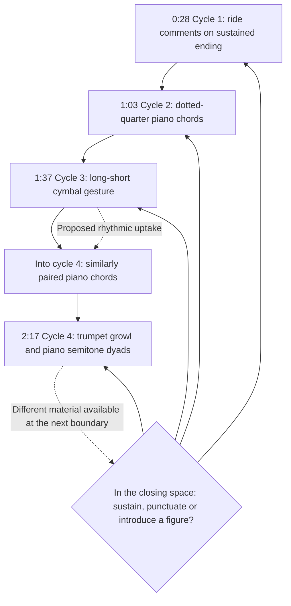
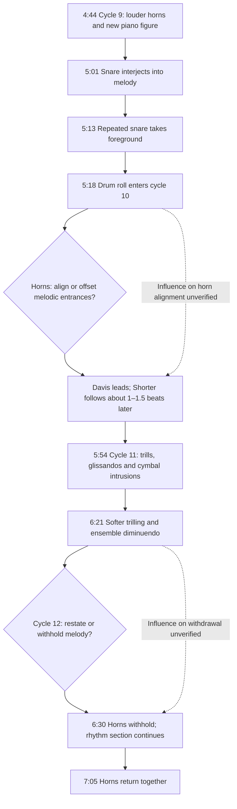
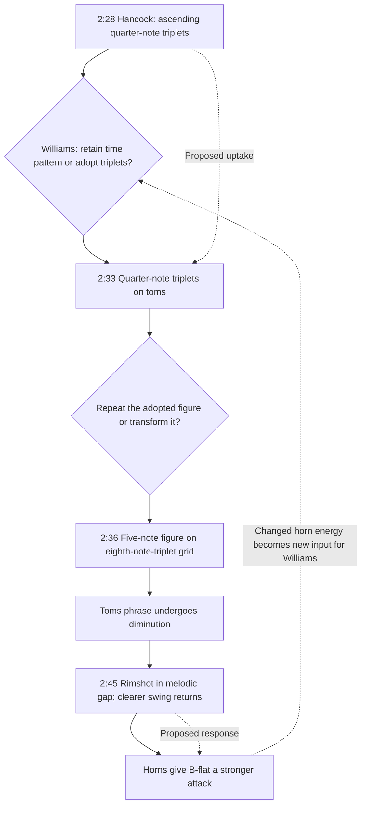
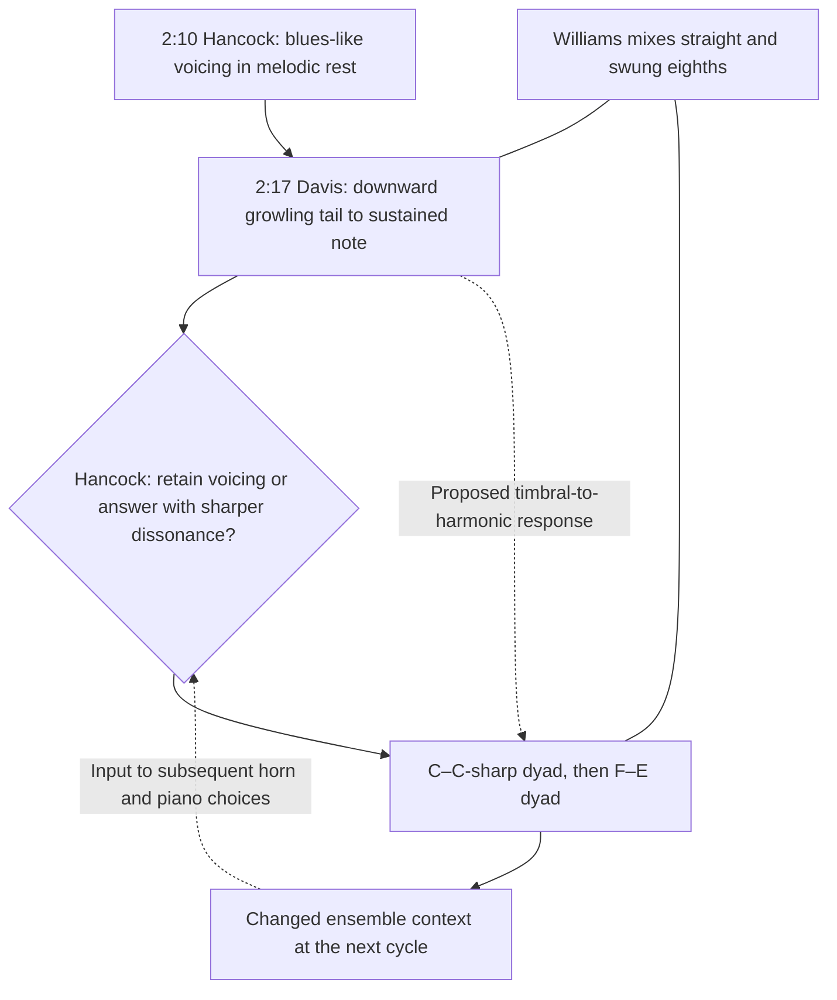
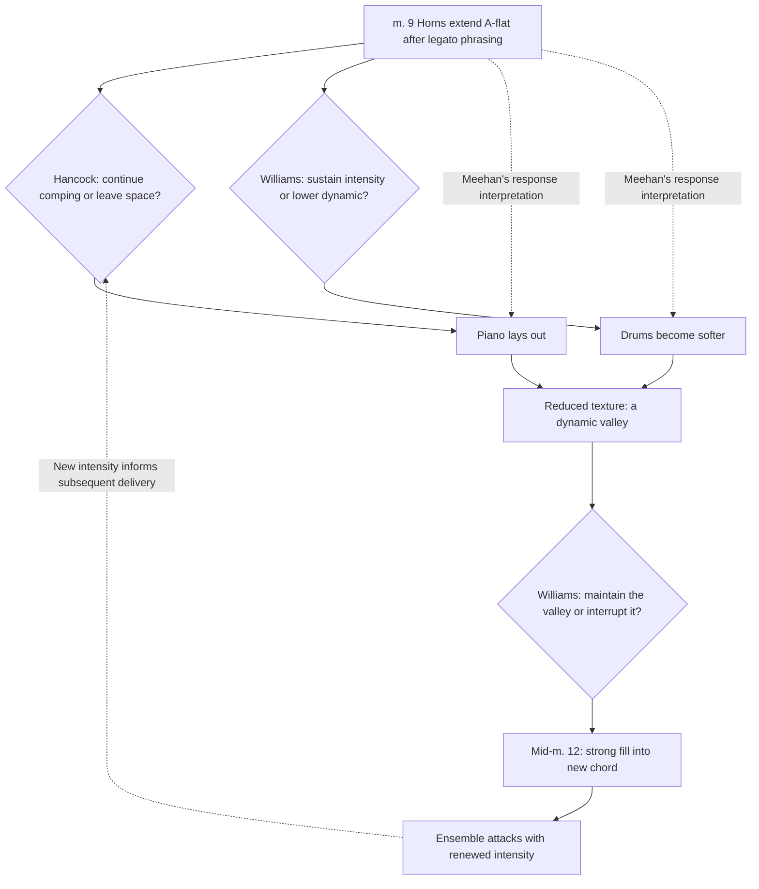

# Nefertiti: Interaction at Three Scales

Snapshot: October 11, 2026

Assigned recording: https://youtu.be/F2zUua79c6U

## Three scales of attention

Keep three zoom levels, without assuming a Schenkerian hierarchy. Performance examines changes in participation and melodic delivery; passage follows developments across cycle boundaries; local exchange examines a gesture, its proposed uptake and its transformation.

Ingrid Monson’s Saying Something places ensemble interaction and rhythm-section creativity at the center of improvisation analysis. That orientation motivates this study; it is not evidence that Monson analyzed this recording. The present summary is grounded in the publisher’s account and table of contents, including “Grooving and Feeling” and “Interaction, Feeling, and Musical Analysis,” rather than an unverified quotation from those chapters. [Monson]

Here, recursion means that an action changes the ensemble context, which becomes an input to subsequent musical choices. Repeating sixteen bars is formal recurrence ; it does not by itself prove interpersonal feedback. A response may preserve, intensify, transform or withdraw material.

Solid arrow · reported sequence / structural relation Dashed arrow · proposed response / feedback Red return · formal recurrence Diamond · specific performance choice inferred from action

Untaken alternatives inside diamonds are analytical contrasts, not additional recorded events. A dashed backward connection means a renewed input to subsequent actions, not a return to an earlier timestamp.

## Graphs

### Participation and changing melodic delivery

Scale: performance

This overview separates formal repetition from interpersonal recursion. The red return closes the sixteen-bar loop. Dashed connections propose that a changed horn delivery affects accompaniment and that the resulting context informs later delivery. They summarize an analytical possibility; the local graphs locate specific supporting events. Diamonds name performance variables, not documented internal deliberations.

Sources: Goldford observations; Meehan pp. 162–163, especially n. 512.

### Closing passages become places to redirect the ensemble

Scale: passage

The chronological path compares closing passages, while the choice node identifies the recurring opportunity: the ending of the melody can coexist with a new accompaniment gesture. Only the cycle-3-to-4 passage currently supplies a proposed cross-boundary imitation; successive closing gestures are not automatically responses to one another.

Sources: Goldford observations at 0:28, 1:03, 1:37 and 2:17.

### From drum interjection to melodic displacement and withdrawal

Scale: passage

This passage preserves the sequence without turning temporal proximity into proven causation. Two specific variables are visible: alignment of the horn parts and presence of the melodic layer. Meehan supports intensified drumming in cycles 9–11 and the absence/return in cycles 12–13, but not every fine-grained gesture or proposed response here.

Sources: Goldford observations; Meehan pp. 162–163; Pasceri title-track paragraph.

### 2:28–2:45 • A piano rhythm is taken up and transformed

Scale: local

This is the strongest current example of a proposed recursive exchange: piano introduces material, drums adopt and transform it, and drum punctuation is followed by changed horn delivery. The dashed return represents a renewed input to subsequent drum choices, not a claim that time runs backward or that a further response has already been identified. Hearing the rimshot as reassurance is Goldford’s interpretation.

Sources: Goldford observations at 2:28, 2:33, 2:36 and 2:45.

### 2:10–2:17 onward • Vocal inflection and semitone dissonance

Scale: local

Goldford hears a correspondence between trumpet’s vocal, blues-associated inflection and piano’s semitone dissonances. This is not literal melodic imitation: a quality is proposed to migrate between timbre and harmony. The return arrow is a model of ongoing responsiveness; the subsequent piano answer still needs identification. Chord alterations and pitches await transcription.

Sources: Goldford observations at 2:10 and 2:17; harmony labels provisional.

### Cycle 5, mm. 9–12 • Extension, withdrawal and renewed intensity

Scale: local

Meehan explicitly links the sustained horn note with piano withdrawal and reduced drum dynamics. The local graph preserves concurrent piano and drum actions rather than making them mutually exclusive. Exact YouTube times remain pending. This m. 12 fill must not be merged with Goldford’s 2:45 rimshot at m. 11.

Sources: Meehan p. 162. YouTube timestamps pending for m. 9 and mid-m. 12.

## Observation ledger

| Time | Position | Event | Relationship | Attribution |
|---|---|---|---|---|
| 0:00 | Cycle 1, m. 1 | Shorter presents the melody without Davis. | Initial single-horn presentation. | Goldford; Meehan p. 162 n. 512 |
| 0:28 | Cycle 1, m. 13 | Ride-cymbal interjections against the final sustained A3. | Closing four bars become an interaction site; preparation of later textures is an interpretation. | Goldford |
| 0:54 | Cycle 2, m. 9; measure discrepancy pending | Davis joins Shorter; ride-bell attacks accompany the entrance. | Brighter drum timbre coincides with thickened horn texture. Visual anticipation by Williams is unverified. | Goldford; Meehan p. 162 n. 512 |
| 1:03 | Cycle 2, m. 13 onward | Piano chords at dotted-quarter intervals; drum punctuation in the final bar. | Cross-beat grouping across the closing passage; possible coordination of punctuation. | Goldford |
| 1:12 | Cycle 3, start | Cycle boundary. | Anchor for the following events. | Goldford |
| 1:25 | Cycle 3, m. 7 | Piano durations span two eighth-note-triplet units; accented repeated E-flats. | A rhythmic layer against the prevailing pulse. | Goldford |
| Pending | Cycle 3, approaching mm. 9–16 | Hancock animates the accompaniment; Williams subsequently takes up its dancing quality. | Meehan explicitly interprets this as uptake. Do not equate it automatically with the 1:25 event. | Meehan p. 162 |
| 1:37 | Cycle 3 closing passage; exact measure pending | Long–short accented, ringing ride-cymbal scrape; similar paired piano chords follow into cycle 4. | Proposed drum-to-piano imitation crosses the cycle boundary. | Goldford |
| 1:48 | Cycle 4, start | Cycle boundary. | Anchor; cymbal gesture from preceding cycle continues. | Goldford |
| 2:10 | Cycle 4, m. 11 | Two piano chords in the melodic rest; blues-like flat-13 voicing over the identified D7-sharp9/B-flat. | Piano introduces a blues-associated color in the melodic gap; voicing needs transcription. | Goldford |
| 2:17 | Cycle 4, m. 14 and following | Davis gives the last note a downward growling glissando; piano follows with C–C-sharp, then F–E dyads. Drums mix swung and straight eighths. | Proposed transfer from vocal trumpet inflection to piano semitone dissonance; final A7 alteration unresolved. | Goldford |
| 2:24 | Cycle 5, start | Cycle boundary. | Anchor for triplet exchange and literature events. | Goldford |
| 2:28 | Cycle 5, m. 3 | Ascending quarter-note triplets in piano. | Hancock introduces the rhythmic material taken up below. | Goldford |
| 2:33 | Cycle 5, m. 5 | Quarter-note triplets on toms. | Williams appears to take up the piano rhythm in a different timbre. | Goldford |
| 2:36 | Cycle 5, m. 7 onward | Five-note spang-a-lang-like tom figure on an eighth-note-triplet grid; subsequent diminution. | Rhythmic uptake is transformed in grouping, duration and drum placement. | Goldford |
| Pending | Cycle 5, m. 9 | Horns extend A-flat after legato delivery; Hancock lays out; Williams lowers his dynamic. | Meehan links horn extension to accompaniment withdrawal and a dynamic valley. | Meehan p. 162 |
| 2:45 | Cycle 5, m. 11 | Loud rimshot in the melodic gap; clearer swing returns; horns deliver B-flat strongly. | Proposed drum-to-horn response. Reassurance and confidence describe an interpretation, not a verified mental state. | Goldford |
| Pending | Cycle 5, midway through m. 12 | Williams plays a strong fill into a new chord; ensemble attacks with renewed intensity. | Meehan reports a coordinated intensification after the valley. Keep distinct from the 2:45 rimshot. | Meehan p. 162 |
| 2:59 | Cycle 6, start | Heavier, more pointed horn attacks, without shorter durations or staccato. | Attack profile changes independently of note length; no specific literature corroboration located. | Goldford |
| 3:34 | Cycle 7, start | Drums take greater liberties. | Specify rhythmic departures through further listening. | Goldford |
| 4:04 | Cycle 7, approximately mm. 15–16 | Ascending chromatic piano figuration over the identified A7-flat9-flat13 turnaround. | Boundary-directed piano gesture; chord and pitches await transcription. | Goldford |
| 4:09 | Cycle 8, start; span pending | Quieter horns, longer sustained notes and fewer intervening rests. | Changes in dynamics and spacing; exact span still open. | Goldford |
| Pending | Cycle 8, second half | Ensemble diminuendo before the more active subsequent drum passages. | Meehan groups cycles 9–11 as intensified drum activity. | Meehan p. 163 |
| 4:44 | Cycle 9, start | New piano figuration, louder horns and changed drum interaction. | Multiple parameters change near the cycle boundary. | Goldford |
| 5:01 | Cycle 9, m. 9 | Repeated intrusive snare hits interject into melodic phrases. | Drums gain foreground prominence. | Goldford |
| 5:13 | Cycle 9, m. 14 | Repeated-snare activity effectively becomes a three-bar drum solo. | Perceived drum foregrounding; not a claim that all other instruments stop. | Goldford |
| 5:18 | Cycle 10, start | Drum roll into the cycle; Davis leads, Shorter follows roughly 1–1.5 quarter-note beats later. | Canon-like melodic displacement; strict canon and response to the roll are unverified. | Goldford |
| 5:54 | Cycle 11, start | Piano eighth-note trill figuration and glissandos; cymbal intrusions. | Interventions overlap or interrupt the horn melody. | Goldford; Meehan p. 163 (broader drum activity) |
| 6:21 | Cycle 11, mm. 13–16 | Ensemble diminuendo with softer piano trilling. | Hancock as initiator is a response hypothesis. | Goldford |
| 6:30 | Cycle 12, start | Both horns absent; simple whole-note piano chords, prominent drums and later drum roll. | Melodic withdrawal redistributes foreground activity. | Goldford; Meehan p. 162 n. 512; Pasceri title-track paragraph |
| 7:05 | Cycle 13, start | Both horns return together, stately and authoritative; rhythms heard as adhering to notation. | Restoration of coordinated melodic delivery; comparison with a specified score remains pending. | Goldford; Meehan p. 162 n. 512 (return) |
| 7:40 | Following boundary / possible partial cycle 14 | No new horn statement; drums and bass continue briefly into a fade. | Released-recording ending, without an invented collective stop cue. | Goldford |

## Open questions

- Davis’s entrance: earlier notes give cycle 2, m. 9; a later description mentions preparation at m. 13. The 0:54 timestamp is retained.

- The exact starting measure of the 1:37 cymbal gesture remains open.

- Goldford’s descriptions alternate between flat-13 and sharp-13 on the final A7 chord; retain the ambiguity until checked.

- Dotted-quarter grouping and triplet-based rhythm do not automatically establish a sustained polymeter.

- The cycle-5 rimshot at 2:45, m. 11, and Meehan’s strong fill midway through m. 12 are separate events.

- Meehan’s 6:32–7:08 timing is not used for navigation: this upload’s cycle-12 and cycle-13 anchors are 6:30 and 7:05.

- The 7:40 boundary may begin a partial fourteenth traversal; it is not a fourteenth horn statement.

## What each source contributes

Interaction analysis supplements pitch, harmony and phrase analysis. The latter explain why returning to the beginning can sound continuous; the event ledger explains how each traversal changes.

- Louis Goldford. Listening observations, October 11, 2026. Source of the YouTube timestamp grid and detailed descriptions of articulation, rhythmic uptake, horn displacement, timbre and piano gestures. Proposed hearing, anticipation, leadership and reassurance are interpretations to test.

- Norman Lawrence Meehan. Creativity in Jazz (2014), pp. 162–163; n. 512. Cycle 3: animated piano accompaniment and proposed drum uptake. Cycle 5: extended A-flat, piano withdrawal, softer drums, and mid-m. 12 fill with renewed ensemble intensity. Cycle 8: second-half diminuendo. Cycles 9–11: active drumming. Cycle 12: horn absence; cycle 13: return. References here use the printed pagination of the supplied thesis, not PDF page numbers.

- Keith Waters. The Studio Recordings of the Miles Davis Quintet, 1965–68 (Oxford University Press, 2011), title-track discussion, pp. 217–219; supplied reflowed chapter, PDF pp. 8–10. Sixteen-bar form, flexible horn delivery and melodic circularity. Phrase openings at m. 9, m. 11 and the next m. 1 trace A-flat–B-flat–C. This explains continuity across the boundary; it does not supply the cycle-6 heavier-attack observation.

- Keith Waters, Henry Martin, Steve Larson and Steven Strunk. “Circular Thinking,” Journal of Jazz Studies 11/1 (2016), 105–120. Waters’s discussion, pp. 113–115, explains phrase overlap and circularity. Strunk’s discussion, pp. 115–117, offers a Schenkerian account involving voice exchange and interruption. These concern compositional structure, rather than documenting instrumental responses at timestamps. Published lead-sheet ending variants are not treated as transcriptions of this performance. Journal search ↗

- William Smither. “Guide-Tone Space: Navigating Voice-Leading Syntax in Tonal Jazz,” Music Theory Online 25/2 (2019), §§2.12–2.14, Examples 14–15; n. 29. Guide-tone continuity provides a harmonic account of circularity. The analysis assumes major sevenths on certain inverted triads; it is not a cycle-by-cycle transcription of Hancock’s voicings. Read article ↗

- Carlo Pasceri. “Nefertiti, l’ultimo capolavoro del Davis acustico,” title-track paragraph; supplied PDF pp. 1–2. Notes the tenor-first presentation, trumpet entry, developing drum activity and a hornless cycle at approximately 6:30 followed by the final melodic return. Timestamps in his discussion of other album tracks are excluded. Read essay ↗

- Ingrid Monson. Saying Something: Jazz Improvisation and Interaction (University of Chicago Press). Methodological context: ensemble interaction, including rhythm-section creativity. The publisher’s description supports this framing, but no chapter-level direct quotation or claim about a Monson analysis of “Nefertiti” is made here. Publisher overview and contents ↗

[Journal search ↗](https://jjs.libraries.rutgers.edu/index.php/jjs/search/search?query=Circular%20Thinking)

[Read article ↗](https://mtosmt.org/issues/mto.19.25.2/mto.19.25.2.smither.php)

[Read essay ↗](https://www.carlopasceri.it/blog/nefertiti-lultimo-capolavoro-del-davis-acustico)

[Publisher overview and contents ↗](https://press.uchicago.edu/ucp/books/book/chicago/S/bo3621755.html)
