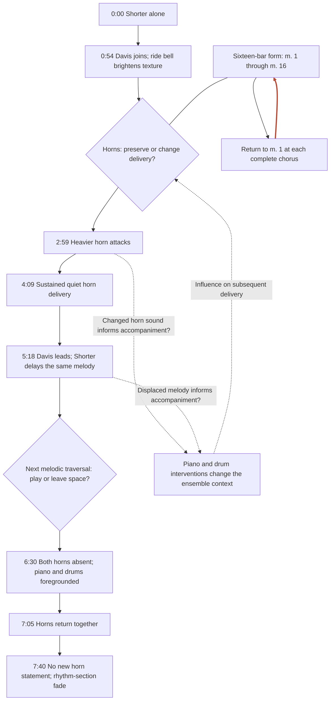
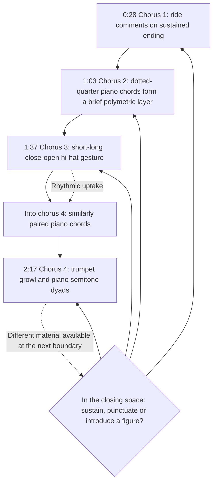
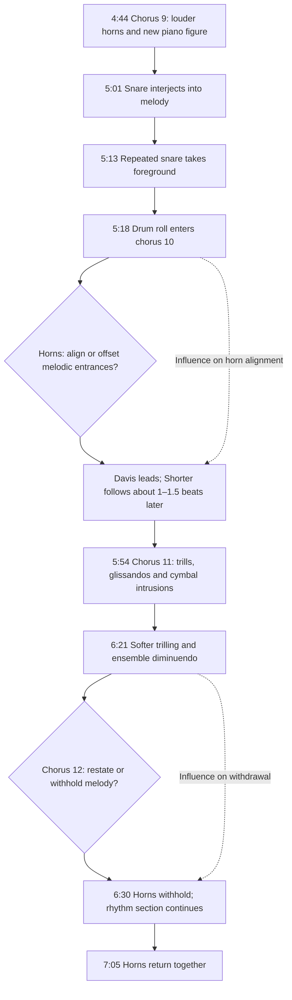
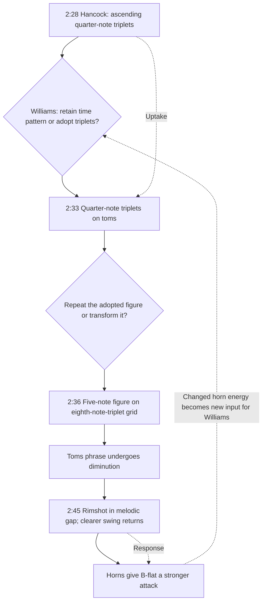
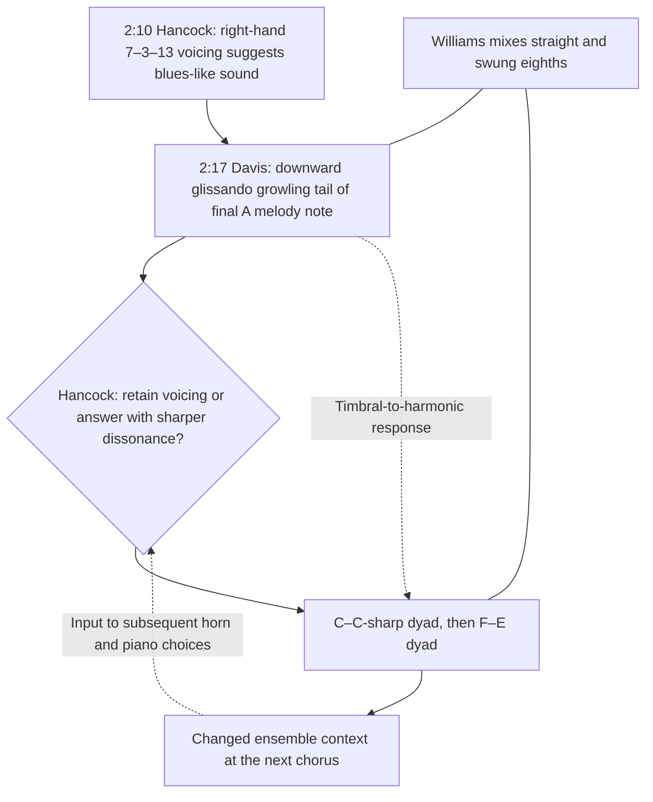
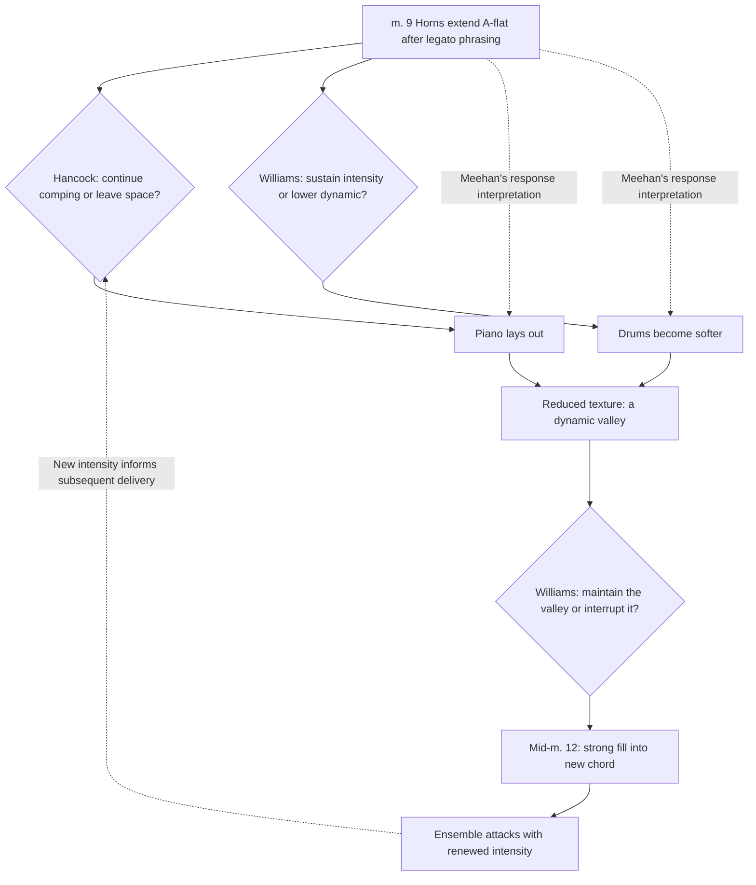

# Nefertiti: Interaction at Three Scales

Last modified: October 11, 2026

Assigned recording: https://youtu.be/F2zUua79c6U

## Three scales of attention

What changes when the melody returns, but the musicians change how they play together? In the Miles Davis Quintet’s “Nefertiti,” recurring statements of Wayne Shorter’s sixteen-bar composition coexist with changes in articulation, rhythmic grouping, instrumental participation, and foreground activity. An account of the composition’s melody and harmony helps explain its continuity. Understanding the particular performance also requires examining how the musicians introduce, answer, transform, and leave space for one another’s ideas.

Ingrid Monson makes this analytical need explicit in *Saying Something: Jazz Improvisation and Interaction*. She proposes a communicative perspective for exploring the “relatively neglected—yet aesthetically central—interactive aspects of jazz improvisation.”[^1] Her starting point is that instrumental roles are interdependent and flexible: musicians make choices “in relationship to what everyone else is doing.”[^2] Interaction therefore belongs within musical analysis itself. It can shape a phrase, redistribute instrumental roles, and contribute to the direction and intensity of an entire performance.

Monson demonstrates this approach at different scales. Her analysis of Geri Allen and Ralph Peterson on “Princess” traces rhythmic interventions, interruptions, and subsequent responses between piano and drums.[^3] Her extended analysis of “Bass-ment Blues” examines how exchanges, recovery, and stylistic references contribute to intensification across successive choruses.[^4] These examples suggest an approach to “Nefertiti” that connects individual gestures with developments across choruses and with changes in the performance as a whole.

David Borgo supplies a complementary account of **recursive interaction**. In *Sync or Swarm*, his discussion developed with Joseph Goguen describes music making and listening as coupled processes: “the current state of each acts as the control of the other.”[^5] Musicians hear the ensemble sound, act in relation to it, and thereby change the sound available for subsequent listening and action. A response can also change how an earlier gesture is understood.[^6] In our analysis, a feedback connection identifies a relationship of this kind. The mere return of the sixteen-bar form establishes recurrence; identifying interpersonal recursion requires evidence of uptake, transformation, or adjustment.

Two further perspectives clarify what this approach attends to. Paul Berliner describes the solo as one strand within a texture whose accompanying parts are themselves commonly improvised.[^7] George E. Lewis emphasizes how personal sound communicates meanings beyond pitches and intervals.[^8] Together, these perspectives encourage attention to the rhythmic and timbral specificity of the quintet’s exchanges: a piano rhythm transferred to toms, a trumpet growl followed by semitone piano dissonances, or a change in horn participation that redistributes foreground activity.

The graphs offer three connected scales of attention:

- **Performance:** How do melodic participation, horn alignment, and instrumental prominence change across the recording? This view connects Shorter’s opening alone, Davis’s entrance, later changes in melodic delivery, the hornless twelfth chorus, and the final melodic return.
- **Passage:** How do exchanges develop across phrases and chorus boundaries? This view examines recurring opportunities for intervention, especially the melody’s closing measures, and follows changes that persist into subsequent choruses.
- **Local exchange:** What does one musician introduce, what follows from another, and how is the material transformed? This view examines specific instances such as Hancock’s quarter-note triplets at 2:28, Williams’s apparent uptake on toms at 2:33, and his subsequent transformation of the figure.

These are complementary zoom levels rather than a fixed hierarchy of musical importance. A local exchange may remain local or contribute to a wider change; the graphs allow those relationships to be investigated. All timestamps refer to the assigned YouTube recording.[^9] Listening observations and literature accounts are attributed separately, and response relationships remain distinguishable from the reported sequence of events.

Solid arrow · reported sequence / structural relation Dashed arrow · response / feedback Red return · formal recurrence Diamond · specific performance choice inferred from action

Untaken alternatives inside diamonds are analytical contrasts, not additional recorded events. A dashed backward connection means a renewed input to subsequent actions, not a return to an earlier timestamp.

[^1]: Ingrid Monson, *Saying Something: Jazz Improvisation and Interaction* (Chicago: University of Chicago Press, 1996), 136.
[^2]: Monson, *Saying Something*, 27.
[^3]: Monson, *Saying Something*, 77–81.
[^4]: Monson, *Saying Something*, 137–91.
[^5]: David Borgo, *Sync or Swarm: Improvising Music in a Complex Age* (New York: Continuum, 2005), 67.
[^6]: Borgo, *Sync or Swarm*, 67–68.
[^7]: Paul F. Berliner, *Thinking in Jazz: The Infinite Art of Improvisation* (Chicago: University of Chicago Press, 1994), 285.
[^8]: George E. Lewis, “Improvised Music after 1950: Afrological and Eurological Perspectives,” *Black Music Research Journal* 22, suppl. (2002): 241, reprinted from *Black Music Research Journal* 16, no. 1 (1996).
[^9]: All timestamps follow Goldford’s timings of the assigned YouTube upload, which may differ from the markers of the 1968 Columbia album release. Meehan places the hornless twelfth chorus and the horns’ return in the thirteenth at 6:32 and 7:08; in this upload the same moments fall at 6:30 and 7:05, an offset of about two to three seconds. Norman Lawrence Meehan, “Creativity in Jazz” (PhD diss., Victoria University of Wellington, 2014), 162n512.
[^10]: Students can use the Mermaid Live Editor to create their own interaction-analysis graphs like these and then include them in their papers. See *Mermaid Live Editor*, accessed October 11, 2026, <https://mermaid.live/>; and “Flowcharts – Basic Syntax,” Mermaid, accessed October 11, 2026, <https://mermaid.js.org/syntax/flowchart.html>.
[^11]: Louis Goldford, listening observations on the Miles Davis Quintet’s “Nefertiti,” unpublished notes, October 11, 2026; Meehan, “Creativity in Jazz,” 162–63, especially 162n512.
[^12]: Goldford, listening observations, at 0:28, 1:03, 1:37, and 2:17.
[^13]: Goldford, listening observations; Meehan, “Creativity in Jazz,” 162–63; Carlo Pasceri, “Nefertiti, l’ultimo capolavoro del Davis acustico,” *Carlo Pasceri* (blog), n.d., title-track paragraph.
[^14]: Goldford, listening observations, at 2:28, 2:33, 2:36, and 2:45.
[^15]: Goldford, listening observations, at 2:10 and 2:17. Harmony labels are provisional.
[^16]: Meehan, “Creativity in Jazz,” 162. YouTube timestamps for m. 9 and mid-m. 12 are pending.
[^17]: Meehan’s “strong fill” midway through m. 12 of chorus 5, followed by renewed ensemble intensity, may be the same event as the loud rimshot heard at 2:45 (chorus 5, m. 11); the two accounts place it a measure apart. Meehan, “Creativity in Jazz,” 162.

## Graphs

Each diagram below is written in Mermaid.[^10]

### Participation and changing melodic delivery

Scale: performance

This overview separates formal repetition from interpersonal recursion. The red return closes the sixteen-bar loop. Dashed connections propose that a changed horn delivery affects accompaniment and that the resulting context informs later delivery. They summarize an analytical possibility; the local graphs locate specific supporting events. Diamonds name performance variables, not documented internal deliberations.[^11]

### Closing passages become places to redirect the ensemble

Scale: passage

The chronological path compares closing passages, while the choice node identifies the recurring opportunity: the ending of the melody can coexist with a new accompaniment gesture. At 1:03, the dotted-quarter piano chords form a brief polymetric layer over the prevailing grid. Only the chorus-3-to-4 passage currently supplies a cross-boundary imitation; successive closing gestures are not automatically responses to one another.[^12]

### From drum interjection to melodic displacement and withdrawal

Scale: passage

This passage preserves the sequence without turning temporal proximity into proven causation. Two specific variables are visible: alignment of the horn parts and presence of the melodic layer. Meehan supports intensified drumming in choruses 9–11 and the absence/return in choruses 12–13, but not every fine-grained gesture or response here.[^13]

### 2:28–2:45 • A piano rhythm is taken up and transformed

Scale: local

This is the strongest current example of a recursive exchange: piano introduces material, drums adopt and transform it, and drum punctuation is followed by changed horn delivery. The quarter-note triplets form a brief polymetric layer: continual, regular durations set against the prevailing grid for no more than a few bars. Fleeting as such layers are, they show how other metrical groupings within the existing grid can be expressive and offer ideas that others take up in turn. The dashed return represents a renewed input to subsequent drum choices, not a claim that time runs backward or that a further response has already been identified. Hearing the rimshot as reassurance is Goldford’s interpretation.[^14]

### 2:10–2:17 onward • Vocal inflection and semitone dissonance

Scale: local

Hancock’s right-hand 7–3–13 voicing at 2:10 creates the blues sound that initiates the entire passage of exchanges. Goldford hears a correspondence between trumpet’s vocal, blues-associated inflection and piano’s semitone dissonances. This is not literal melodic imitation: a quality is proposed to migrate between timbre and harmony. The return arrow is a model of ongoing responsiveness; the subsequent piano answer still needs identification. Chord alterations and pitches await transcription.[^15]

### Chorus 5, mm. 9–12 • Extension, withdrawal and renewed intensity

Scale: local

Meehan explicitly links the sustained horn note with piano withdrawal and reduced drum dynamics. The local graph preserves concurrent piano and drum actions rather than making them mutually exclusive. Exact YouTube times remain pending. This m. 12 fill may be the same event as Goldford’s 2:45 rimshot at m. 11.[^16]

## Observation ledger

| Time | Position | Event | Relationship | Attribution |
|---|---|---|---|---|
| 0:00 | Chorus 1, m. 1 | Shorter presents the melody without Davis. | Initial single-horn presentation. | Goldford; Meehan p. 162 n. 512 |
| 0:28 | Chorus 1, m. 13 | Ride-cymbal interjections against the final sustained A3. | Closing four bars become an interaction site; preparation of later textures is an interpretation. | Goldford |
| 0:54 | Chorus 2, m. 9 | Davis joins Shorter; ride-bell attacks accompany the entrance. | Brighter drum timbre coincides with thickened horn texture. Visual anticipation by Williams is unverified. | Goldford; Meehan p. 162 n. 512 |
| 1:03 | Chorus 2, m. 13 onward | Piano chords at dotted-quarter intervals; drum punctuation in the final bar. | Brief polymetric layer: regular dotted-quarter durations overlay the prevailing grid across the closing passage; possible coordination of punctuation. | Goldford |
| 1:12 | Chorus 3, start | Chorus boundary. | Anchor for the following events. | Goldford |
| 1:25 | Chorus 3, m. 7 | Piano durations span two eighth-note-triplet units; accented repeated E-flats. | Brief polymetric layer: regular durations of two eighth-note-triplet units overlay the prevailing pulse. | Goldford |
| Pending | Chorus 3, approaching mm. 9–16 | Hancock animates the accompaniment; Williams subsequently takes up its dancing quality. | Meehan explicitly interprets this as uptake. Do not equate it automatically with the 1:25 event. | Meehan p. 162 |
| 1:37 | Chorus 3, m. 12 | Short–long accented, close-open hi-hat gesture; similar paired piano chords follow into chorus 4. | Drum-to-piano imitation crosses the chorus boundary. | Goldford |
| 1:48 | Chorus 4, start | Chorus boundary. | Anchor; hi-hat gesture from preceding chorus continues. | Goldford |
| 2:10 | Chorus 4, m. 11 | Two piano chords in the melodic rest; Hancock’s right hand voices 7–3–13 over the identified D7-sharp9/B-flat, creating a blues sound. | This blues voicing initiates the entire passage of exchanges that follows. | Goldford |
| 2:17 | Chorus 4, m. 14 and following | Davis gives the last note a downward growling glissando; piano follows with C–C-sharp, then F–E dyads. Drums mix swung and straight eighths. | Transfer from vocal trumpet inflection to piano semitone dissonance; final chord is A7-flat9-13. | Goldford |
| 2:24 | Chorus 5, start | Chorus boundary. | Anchor for triplet exchange and literature events. | Goldford |
| 2:28 | Chorus 5, m. 3 | Ascending quarter-note triplets in piano. | Hancock introduces the rhythmic material taken up below. | Goldford |
| 2:33 | Chorus 5, m. 5 | Quarter-note triplets on toms. | Williams appears to take up the piano rhythm in a different timbre. | Goldford |
| 2:36 | Chorus 5, m. 7 onward | Five-note spang-a-lang-like tom figure on an eighth-note-triplet grid; subsequent diminution. | Rhythmic uptake is transformed in grouping, duration and drum placement. | Goldford |
| Pending | Chorus 5, m. 9 | Horns extend A-flat after legato delivery; Hancock lays out; Williams lowers his dynamic. | Meehan links horn extension to accompaniment withdrawal and a dynamic valley. | Meehan p. 162 |
| 2:45 | Chorus 5, m. 11 | Loud rimshot in the melodic gap; clearer swing returns; horns deliver B-flat strongly. | Drum-to-horn response. Reassurance and confidence describe an interpretation, not a verified mental state. | Goldford |
| Pending | Chorus 5, midway through m. 12 | Williams plays a strong fill into a new chord; ensemble attacks with renewed intensity. | Meehan reports a coordinated intensification after the valley. Possibly the same event as the 2:45 rimshot at m. 11.[^17] | Meehan p. 162 |
| 2:59 | Chorus 6, start | Heavier, more pointed horn attacks, without shorter durations or staccato. | Attack profile changes independently of note length; no specific literature corroboration located. | Goldford |
| 3:34 | Chorus 7, start | Drums take greater liberties. | Specify rhythmic departures through further listening. | Goldford |
| 4:04 | Chorus 7, approximately mm. 15–16 | Ascending chromatic piano figuration over the identified A7-flat9-13 turnaround. | Boundary-directed piano gesture; pitches await transcription. | Goldford |
| 4:09 | Chorus 8, start; span pending | Quieter horns, longer sustained notes and fewer intervening rests. | Changes in dynamics and spacing; exact span still open. | Goldford |
| Pending | Chorus 8, second half | Ensemble diminuendo before the more active subsequent drum passages. | Meehan groups choruses 9–11 as intensified drum activity. | Meehan p. 163 |
| 4:44 | Chorus 9, start | New piano figuration, louder horns and changed drum interaction. | Multiple parameters change near the chorus boundary. | Goldford |
| 5:01 | Chorus 9, m. 9 | Repeated intrusive snare hits interject into melodic phrases. | Drums gain foreground prominence. | Goldford |
| 5:13 | Chorus 9, m. 14 | Repeated-snare activity effectively becomes a three-bar drum solo. | Perceived drum foregrounding; not a claim that all other instruments stop. | Goldford |
| 5:18 | Chorus 10, start | Drum roll into the chorus; Davis leads, Shorter follows roughly 1–1.5 quarter-note beats later. | Canon-like melodic displacement; strict canon and response to the roll are unverified. | Goldford |
| 5:54 | Chorus 11, start | Piano eighth-note trill figuration and glissandos; cymbal intrusions. | Interventions overlap or interrupt the horn melody. | Goldford; Meehan p. 163 (broader drum activity) |
| 6:21 | Chorus 11, mm. 13–16 | Ensemble diminuendo with softer piano trilling. | Hancock as initiator is a response hypothesis. | Goldford |
| 6:30 | Chorus 12, start | Both horns absent; simple whole-note piano chords, prominent drums and later drum roll. | Melodic withdrawal redistributes foreground activity. | Goldford; Meehan p. 162 n. 512; Pasceri title-track paragraph |
| 7:05 | Chorus 13, start | Both horns return together, stately and authoritative; rhythms heard as adhering to notation. | Restoration of coordinated melodic delivery; comparison with a specified score remains pending. | Goldford; Meehan p. 162 n. 512 (return) |
| 7:40 | After chorus 13; vamp out | Vamp out: no new horn statement; time continues in drums and bass briefly into a fade. | Released-recording ending, without an invented collective stop cue. Time continues, but nothing in any part suggests that a new chorus has begun. | Goldford |

## Bibliography

Berliner, Paul F. *Thinking in Jazz: The Infinite Art of Improvisation*. Chicago: University of Chicago Press, 1994.

Borgo, David. *Sync or Swarm: Improvising Music in a Complex Age*. New York: Continuum, 2005.

Goldford, Louis. Listening observations on the Miles Davis Quintet’s “Nefertiti.” Unpublished notes, October 11, 2026.

Lewis, George E. “Improvised Music after 1950: Afrological and Eurological Perspectives.” *Black Music Research Journal* 22, suppl. (2002): 215–46. Originally published in *Black Music Research Journal* 16, no. 1 (1996): 91–122.

Meehan, Norman Lawrence. “Creativity in Jazz.” PhD diss., Victoria University of Wellington, 2014.

Mermaid. “Flowcharts – Basic Syntax.” Accessed October 11, 2026. <https://mermaid.js.org/syntax/flowchart.html>.

———. *Mermaid Live Editor*. Accessed October 11, 2026. <https://mermaid.live/>.

Monson, Ingrid. *Saying Something: Jazz Improvisation and Interaction*. Chicago: University of Chicago Press, 1996.

Pasceri, Carlo. “Nefertiti, l’ultimo capolavoro del Davis acustico.” *Carlo Pasceri* (blog), n.d. <https://www.carlopasceri.it/blog/nefertiti-lultimo-capolavoro-del-davis-acustico>.

Smither, William. “Guide-Tone Space: Navigating Voice-Leading Syntax in Tonal Jazz.” *Music Theory Online* 25, no. 2 (2019). <https://mtosmt.org/issues/mto.19.25.2/mto.19.25.2.smither.php>.

Waters, Keith. *The Studio Recordings of the Miles Davis Quintet, 1965–68*. New York: Oxford University Press, 2011.

Waters, Keith, Henry Martin, Steve Larson, and Steven Strunk. “Circular Thinking.” *Journal of Jazz Studies* 11, no. 1 (2016): 105–20.

## How to cite

Bibliography: Goldford, Louis. “Nefertiti: Interaction at Three Scales.” Last modified October 11, 2026. <https://einbahnstrasse.github.io/nefertiti-analysis/>.

Note: Louis Goldford, “Nefertiti: Interaction at Three Scales,” last modified October 11, 2026, <https://einbahnstrasse.github.io/nefertiti-analysis/>.
