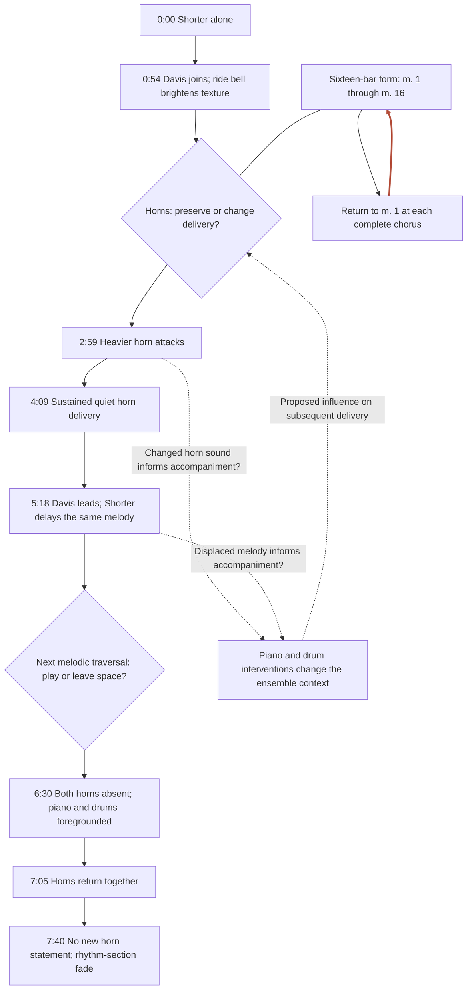

# Participation and changing melodic delivery

Scale: performance

This overview separates formal repetition from interpersonal recursion. The red return closes the sixteen-bar loop. Dashed connections propose that a changed horn delivery affects accompaniment and that the resulting context informs later delivery. They summarize an analytical possibility; the local graphs locate specific supporting events. Diamonds name performance variables, not documented internal deliberations.

Sources: Goldford observations; Meehan pp. 162–163, especially n. 512.

