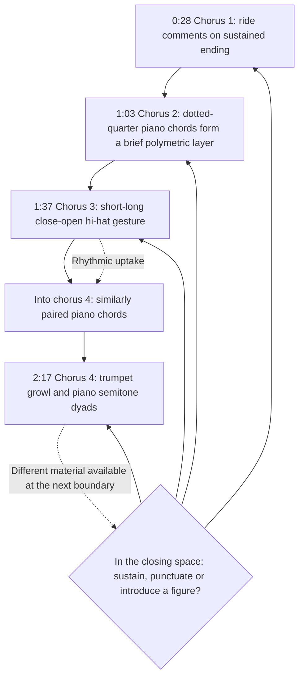

# Closing passages become places to redirect the ensemble

Scale: passage

The chronological path compares closing passages, while the choice node identifies the recurring opportunity: the ending of the melody can coexist with a new accompaniment gesture. At 1:03, the dotted-quarter piano chords form a brief polymetric layer over the prevailing grid. Only the chorus-3-to-4 passage currently supplies a cross-boundary imitation; successive closing gestures are not automatically responses to one another.

Sources: Goldford observations at 0:28, 1:03, 1:37 and 2:17.

