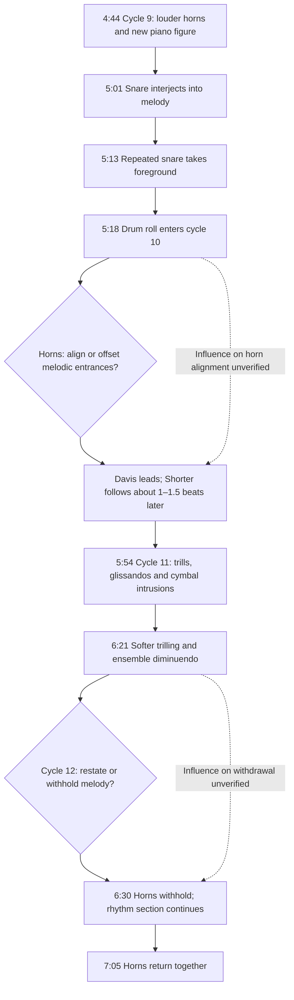

# From drum interjection to melodic displacement and withdrawal

Scale: passage

This passage preserves the sequence without turning temporal proximity into proven causation. Two specific variables are visible: alignment of the horn parts and presence of the melodic layer. Meehan supports intensified drumming in cycles 9–11 and the absence/return in cycles 12–13, but not every fine-grained gesture or proposed response here.

Sources: Goldford observations; Meehan pp. 162–163; Pasceri title-track paragraph.

