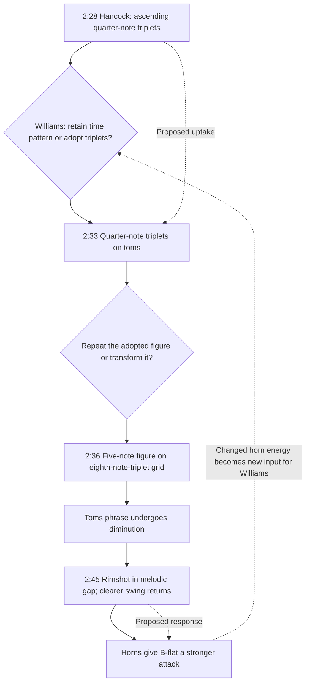

# 2:28–2:45 • A piano rhythm is taken up and transformed

Scale: local

This is the strongest current example of a proposed recursive exchange: piano introduces material, drums adopt and transform it, and drum punctuation is followed by changed horn delivery. The quarter-note triplets form a brief polymetric layer: continual, regular durations set against the prevailing grid for no more than a few bars. Fleeting as such layers are, they show how other metrical groupings within the existing grid can be expressive and offer ideas that others take up in turn. The dashed return represents a renewed input to subsequent drum choices, not a claim that time runs backward or that a further response has already been identified. Hearing the rimshot as reassurance is Goldford’s interpretation.

Sources: Goldford observations at 2:28, 2:33, 2:36 and 2:45.

