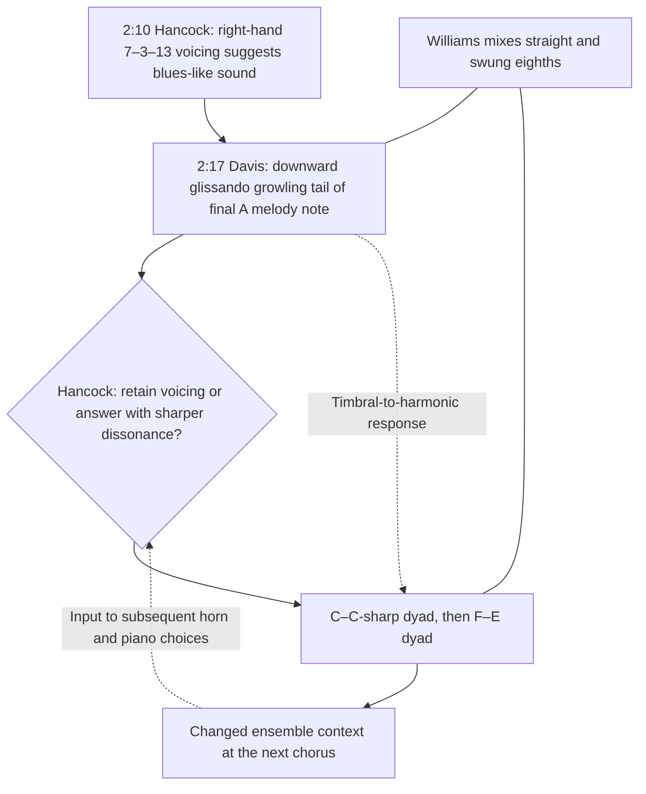

# 2:10–2:17 onward • Vocal inflection and semitone dissonance

Scale: local

Hancock’s right-hand 7–3–13 voicing at 2:10 creates the blues sound that initiates the entire passage of exchanges. Goldford hears a correspondence between trumpet’s vocal, blues-associated inflection and piano’s semitone dissonances. This is not literal melodic imitation: a quality is proposed to migrate between timbre and harmony. The return arrow is a model of ongoing responsiveness; the subsequent piano answer still needs identification. Chord alterations and pitches await transcription.

Sources: Goldford observations at 2:10 and 2:17; harmony labels provisional.

