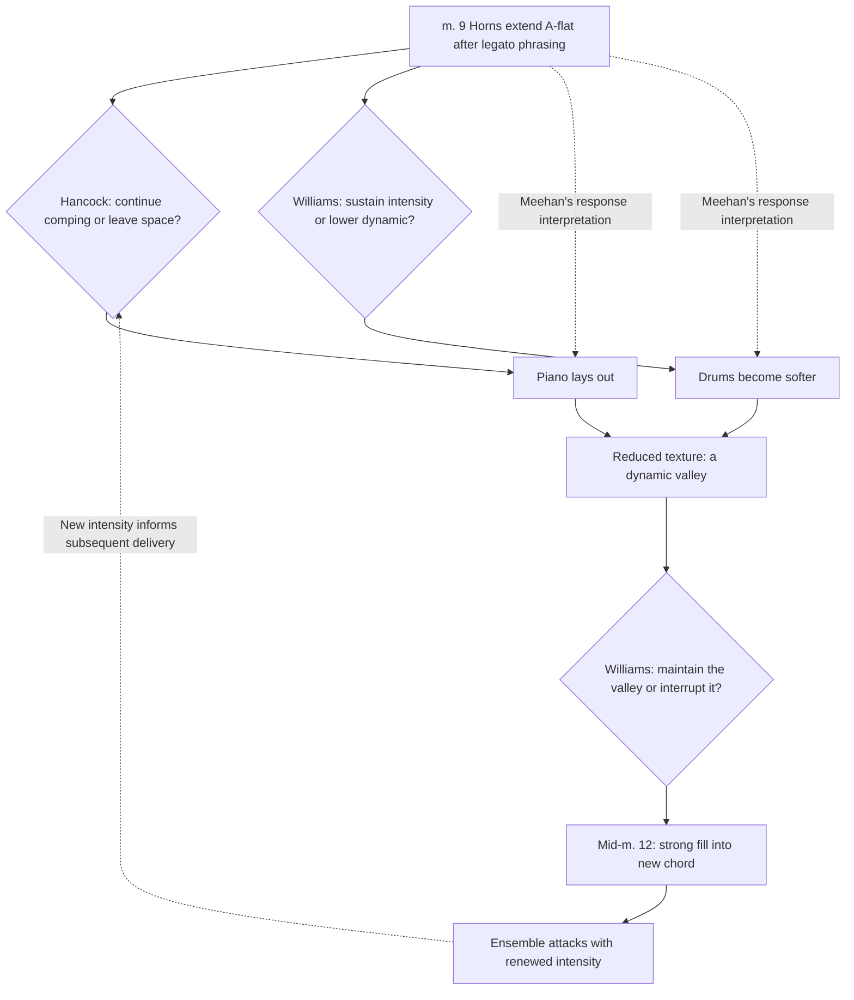

# Chorus 5, mm. 9–12 • Extension, withdrawal and renewed intensity

Scale: local

Meehan explicitly links the sustained horn note with piano withdrawal and reduced drum dynamics. The local graph preserves concurrent piano and drum actions rather than making them mutually exclusive. Exact YouTube times remain pending. This m. 12 fill may be the same event as Goldford’s 2:45 rimshot at m. 11.

Sources: Meehan p. 162. YouTube timestamps pending for m. 9 and mid-m. 12.

